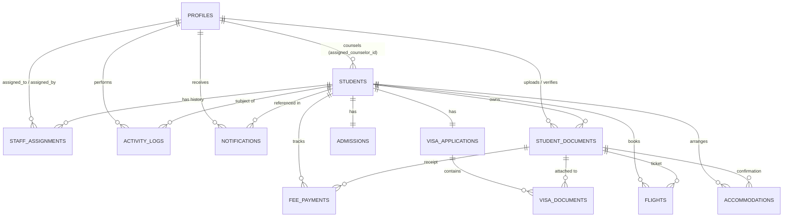

# Admission & Visa Tracking Management System — Architecture & Implementation Plan

## 1. Database Architecture

The database is designed on **Supabase PostgreSQL** using normalized tables, strict PostgreSQL `ENUM` types, UUID primary keys (`gen_random_uuid()`), automatic `updated_at` triggers, auto-generated `student_code` (`STU-YYYY-XXXX`), `CHECK` constraints, foreign key integrity, and Row Level Security (RLS).

### Tables Overview (12 Core Tables + System Settings)

1. **`profiles`** — Staff user accounts (`super_admin`, `admin`, `counselor`, `viewer`), password hashes (`bcrypt`), active status, and department metadata.
2. **`students`** — Core student bio, passport, destination university/course, intake, assigned counselor (`profiles.id`), and soft-delete fields (`deleted_at`).
3. **`admissions`** — 1-to-1 admission workflow tracking per student (`admission_status`, offer letter details, remarks, updated by).
4. **`fee_payments`** — Admission fee ledger supporting one or more payment records / summary tracking per student (`total_fee`, `amount_paid`, generated `outstanding_amount`, `payment_status`, `payment_date`, `payment_reference`, `receipt_document_id`).
5. **`visa_applications`** — 1-to-1 visa documentation and visa eligibility tracking per student (`doc_status`, `eligibility_status`, `eligibility_remarks`, `verification_date`, `verified_by`).
6. **`visa_documents`** — Checklist & linkage of visa-specific document items linked to `visa_applications` and `student_documents`.
7. **`flights`** — Flight booking lifecycle per student (`flight_status`, airline, flight number, departure/arrival airports, departure date, booking reference, `ticket_document_id`).
8. **`accommodations`** — Accommodation requirement & payment tracking (`requirement_status`, `payment_status`, provider, property name, address, check-in/out dates, payment amount, `confirmation_document_id`, remarks).
9. **`student_documents`** — Metadata and versioning for private Supabase Storage objects (`category`, `file_name`, `storage_path`, `mime_type`, `file_size`, `version_number`, `document_group_id`, `is_latest`, `verification_status`, `uploaded_by`).
10. **`staff_assignments`** — Audit history of counselor assignments and reassignments per student.
11. **`activity_logs`** — Immutable audit trail of all CRUD, status transitions, payment events, document actions, and logins.
12. **`notifications`** — Staff notifications triggered by assignments, status changes, payments, visa readiness/eligibility, flight bookings, and accommodation reservations.
13. **`system_settings`** — Configurable organization defaults (academic year, intakes, supported countries, file limits) managed by Super Admins.

---

## 2. Entity-Relationship (ER) Diagram



---

## 3. Project Folder Structure

```text
edu_crm/
├── README.md
├── docs/
│   └── ARCHITECTURE.md
├── supabase/
│   ├── migrations/
│   │   ├── 001_enums_and_extensions.sql
│   │   ├── 002_core_tables.sql
│   │   ├── 003_triggers_and_functions.sql
│   │   └── 004_rls_and_storage.sql
│   └── seed.sql
├── backend/
│   ├── package.json
│   ├── .env.example
│   ├── tests/
│   └── src/
│       ├── app.js
│       ├── server.js
│       ├── config/
│       ├── controllers/
│       ├── middleware/
│       ├── repositories/
│       ├── routes/
│       ├── services/
│       ├── utils/
│       └── validators/
└── frontend/
    ├── package.json
    ├── .env.example
    ├── index.html
    ├── tailwind.config.js
    ├── postcss.config.js
    ├── vite.config.js
    └── src/
        ├── App.jsx
        ├── main.jsx
        ├── index.css
        ├── assets/
        ├── components/
        ├── context/
        ├── features/
        ├── hooks/
        ├── layouts/
        ├── pages/
        ├── routes/
        ├── services/
        └── utils/
```

---

## 4. Implementation Plan

1. **Database & Storage Layer (`supabase/`)**: Define PostgreSQL ENUMs, normalized 12+1 tables, constraints, triggers (`updated_at`, `student_code`), RLS policies, private `student-documents` Storage bucket, and realistic seed data.
2. **Backend Core (`backend/src/config`, `middleware`, `utils`)**: Configure Supabase service client, JWT + bcrypt auth, RBAC (`super_admin`, `admin`, `counselor`, `viewer`) + counselor assignment scoping, Zod validation, Helmet, CORS, rate limiting, Multer memory upload validation, and centralized error handling.
3. **Backend Domain Layers (`repositories`, `services`, `controllers`, `routes`)**: Implement full CRUD, 6-stage progress calculation (never counting in-progress as complete), document versioning & signed URLs, activity logging, notifications, analytics/charts, and CSV/Excel exports.
4. **Frontend Shell & Design System (`frontend/src/`)**: Build Linear/Stripe-inspired UI with dark navy sidebar, responsive drawer, status badges, AuthContext, Toast notifications, and reusable DataTable/Pagination/Modal components.
5. **Frontend Modules**: Build all 12 sidebar modules + Student Profile 6-stage tracker + Recharts analytics + Document preview/versioning + Reports export + RBAC UI guards.
6. **Verification**: Run backend automated tests (RBAC, validation, progress tracker, API endpoints) and frontend production build verification.

